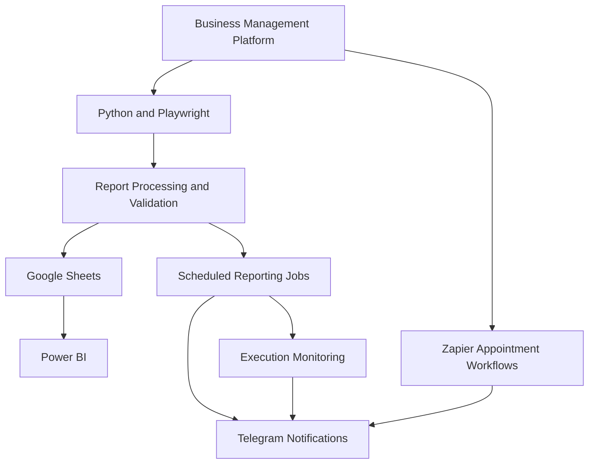

# Business Operations Automation Platform

### Python | Playwright | Zapier | Telegram | Google Sheets | Power BI | AI-Assisted Development

## Project Overview

An independently developed business automation platform designed to streamline reporting, operational monitoring, and administrative workflows across two business locations.

The platform replaces repetitive manual reporting activities with scheduled automation, data processing, and exception-based notifications.

Development was guided using ChatGPT and OpenAI Codex for AI-assisted coding, debugging, testing, and maintenance.

**Project Type:** Independent Software Engineering Project  
**Role:** Automation Solution Designer & Developer  
**Development:** 2026 – Present  
**Production Source Code:** Private

---

## Business Problem

Daily business operations required manual retrieval, review, and organization of information from a third-party business management system.

These activities included:
- Reviewing operational reports
- Monitoring appointments and membership activity
- Identifying outstanding payment issues
- Organizing financial transactions
- Preparing daily, weekly, and monthly summaries
- Communicating operational updates

The routine manual review process previously required approximately 2.5 hours per week per location.

Across two locations, this represented approximately 260 hours of manual work annually.

## Solution

Designed a modular automation platform that:

1. Retrieves operational data through browser-based automation.
2. Processes and standardizes downloaded reports.
3. Generates scheduled summaries.
4. Delivers notifications through Telegram.
5. Integrates financial data with Google Sheets and Power BI.
6. Tracks execution status and identifies failures.
7. Supports exception-based monitoring instead of routine manual review.

## System Architecture

*Conceptual architecture. Implementation details and production credentials are intentionally excluded.*

## Technology Stack

| Category | Technology |
|---|---|
| Programming | Python |
| Browser Automation | Playwright |
| Workflow Automation | Zapier |
| Notifications | Telegram |
| Data Processing | CSV, Python |
| Data Storage and Reporting | Google Sheets |
| Business Intelligence | Power BI |
| Scheduling | macOS LaunchAgents |
| Source Control | Git, GitHub |
| AI-Assisted Development | ChatGPT, OpenAI Codex |
| Development Environment | VS Code |
| Reliability | Execution Tracking, Retries, Logging |

## Key Features

### 1. Automated Operational Reporting

- Daily operational reports
- Weekly reporting summaries
- Monthly financial reporting
- Membership activity monitoring
- Outstanding payment reporting
- Appointment activity reporting

### 2. Telegram Notifications

Automated notifications provide operational visibility without requiring repeated manual system access.

Separate notification workflows support business locations and reporting requirements.

### 3. Appointment Notifications

Implemented Zapier-based workflows to:

- Send daily appointment notifications
- Deliver weekly appointment summaries every Sunday
- Provide location-specific scheduling information

### 4. Financial Reporting Integration

- Retrieve financial transaction reports
- Standardize downloaded transaction data
- Synchronize reporting data with Google Sheets
- Support financial analysis using Power BI

### 5. Reliability Engineering

The automation platform incorporates:

- Scheduled execution
- Job execution tracking
- Retry mechanisms
- Failure notifications
- Structured logging
- Validation of downloaded data
- Monitoring of recurring job execution

### 6. Security Considerations

- Private production repository
- Secure credential management
- Protected authentication information
- Separation of development and production environments
- No production business data published in this repository

## Business Impact

| Metric | Result |
|---|---|
| Locations supported | 2 |
| Previous manual review per location | 2.5 hours/week |
| Previous total manual review | 5 hours/week |
| Annual manual review baseline | 260 hours |
| Current review approach | Exception-based monitoring |

The platform replaced routine manual reporting reviews with automated notifications.

Manual investigation is now generally required only when a notification raises a question or requires further review.

The 260-hour figure represents the previous annual workload, not a measured net time-savings figure.

## AI-Assisted Development Approach

The project was conceived independently and developed with assistance from ChatGPT and OpenAI Codex.

Responsibilities included:

- Identifying business automation opportunities
- Defining functional requirements
- Designing automation workflows
- Guiding AI-assisted code generation
- Reviewing and validating implementation behavior
- Troubleshooting integration and execution issues
- Testing changes and improving reliability
- Maintaining source control and project documentation

AI tools assisted software development; this does not imply that every production workflow uses generative AI.

## Planned Enhancements

### Audit Trail Analysis

Analyze business application audit records to identify modifications to employee time entries.

### AI-Powered Activity Summaries

Use AI to summarize daily business activities recorded in application audit trails.

These features are planned and are not represented as completed production capabilities.

## Engineering Skills Demonstrated

- Business process analysis
- Automation solution design
- Python development
- Browser-based workflow automation
- Third-party integrations
- Data extraction and transformation
- Scheduled job orchestration
- Error handling and recovery
- Application monitoring
- Technical testing and validation
- AI-assisted software development
- Operational reporting

## Confidentiality

This repository contains a high-level technical case study only.

The underlying production application, credentials, configuration, business records, and proprietary integration details are not publicly available.

The project is independently developed and is not presented as an official product or endorsement by any third-party software vendor.
